# Roadster Thruster Lab

How does a car jump over five other cars, hover and drive upside down? On 15 October 2026 Tesla showed the new Roadster doing exactly that, using cold-gas thrusters developed with SpaceX and suction fans under the floor. This project rebuilds the physics from first principles, twice:

**▶ Try it live: [krishnaiyer1007.github.io/roadster-thruster-lab](https://krishnaiyer1007.github.io/roadster-thruster-lab/)**

1. **An interactive web model** you can play with in any browser. Change the tank pressure or the car's mass and watch every scenario re-run.
2. **MATLAB and Simulink models** of the same system, with a Stateflow mission manager, a pitch control loop and a landing burn. They are cross-checked against the web model and agree to within about 1%.

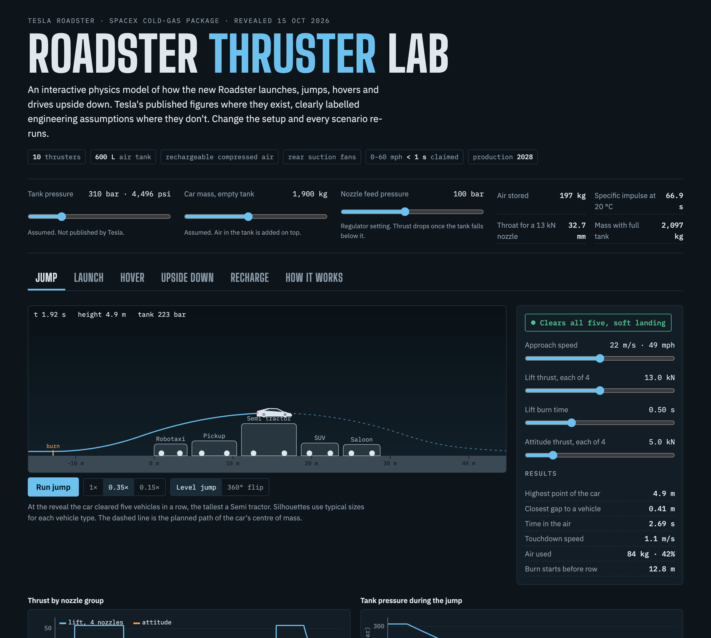

> Independent model built from public reporting. Not affiliated with Tesla or SpaceX. Where Tesla hasn't published a number, the model uses a clearly labelled engineering assumption.

---

## What the model finds

| Question | Answer from the model |
|---|---|
| Can two rear thrusters really beat 1 second to 60 mph? | Yes. Tyres alone cap out at **2.13 s**. Suction fans get it to **1.20 s**. Add two 13 kN rear thrusters and it's **0.77 s**, using about 31 kg of air. |
| How does it clear five vehicles? | A half-second lift burn, then it flies like a thrown ball. A **4.9 m** apex clears the 4.1 m Semi with **0.46 m** to spare, and a landing burn sets it down at **1.1 m/s**. |
| How long can it hover? | About **4.5 seconds** airborne. Holding up a two-tonne car burns roughly 30 kg of air every second. |
| Why so short? | Cold air is a weak propellant (about **67 s** specific impulse), and the tank cools to around **−99 °C** as it empties, so each kilogram pushes less. |
| Can fans hold it on a ceiling? | Yes, with 8 kPa of suction over 3 m². Upside down isn't the hardest angle though. Between about **120° and 165°** the car slides off. |
| What does a refill cost? | A full 600 L tank takes about **57 kWh** to recompress. That's roughly **170 miles** of driving range. One launch costs about 27 miles. |
| Would a 360° flip work? | Not with 5 kN corner thrusters. The car can't rotate fast enough, and a full flip leaves too little air for a soft landing. |

---

## Run it

### Web model (no install)

Open `web/index.html` in a browser, or serve it locally:

```bash
npm start          # http://localhost:8080
npm test           # physics regression tests (Node 18+)
```

It also works as a static site on GitHub Pages: point Pages at the repo root and open `/web/`.

### MATLAB and Simulink (R2025b, Simulink + Stateflow)

```matlab
cd matlab
run_all('rebuild')   % builds the three .slx models, runs every scenario,
                     % saves figures to docs/figures and writes docs/validation.md
open_system('models/RoadsterJump.slx')
```

In VS Code, the same steps are under **Terminal → Run Task**.

---

## How it works

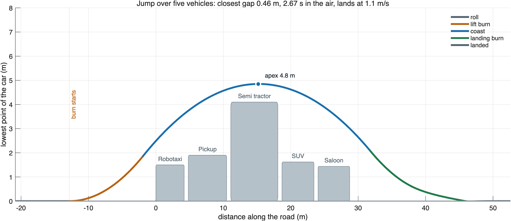

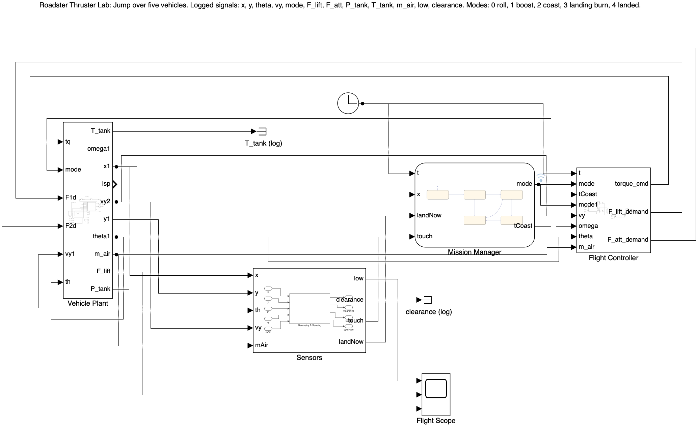

**Tank and nozzles.** A 600 L composite tank holds about 197 kg of air at 310 bar. A regulator feeds the nozzles at 100 bar. Each nozzle is choked (the air leaves faster than sound), so thrust and air use follow from the textbook relations:

```
F    = C_F · p_c · A_t              thrust
ṁ    = F / (I_sp · g₀)              air used per second
I_sp = C_F · c* / g₀  ≈ 67 s         at 20 °C, area ratio 8
p    = p₀ (m/m₀)^γ,  T = T₀ (m/m₀)^(γ−1)   adiabatic tank blowdown
```

**Ten nozzles, three jobs.** Tesla confirmed ten thrusters. The model splits them into 2 rear (acceleration), 4 under the floor (lift) and 4 at the corners (pitch control).

**Flight logic.** In Simulink, a Stateflow chart runs the jump: roll, boost, coast, landing burn, landed. The landing burn starts when the car's stopping distance at the available thrust matches its height.

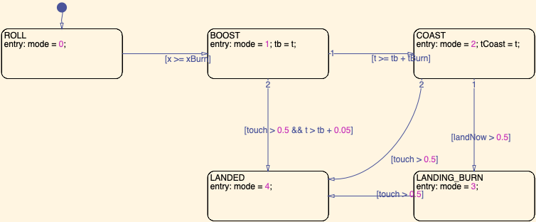

**Pitch control.** A PD loop with a torque limit keeps the car level, using the corner thrusters.

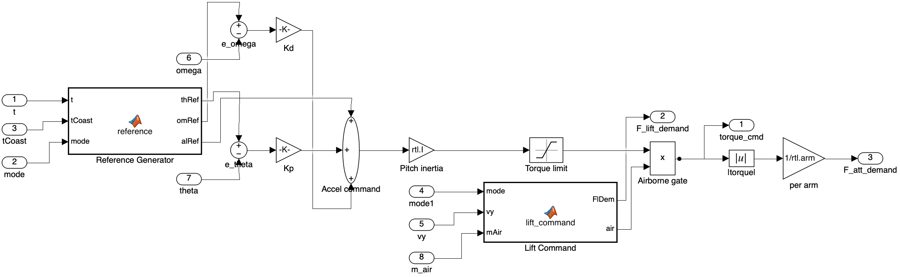

---

## Results

| | |
|---|---|
| 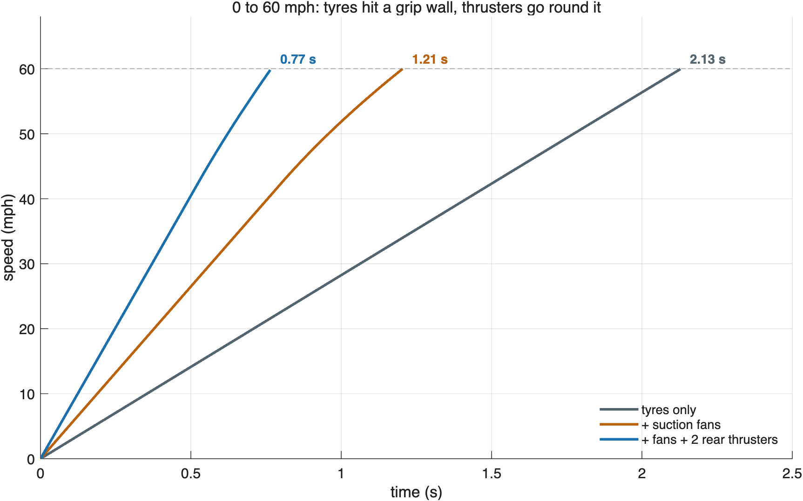 | 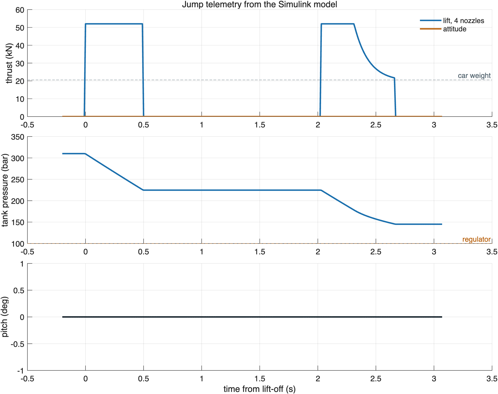 |
| 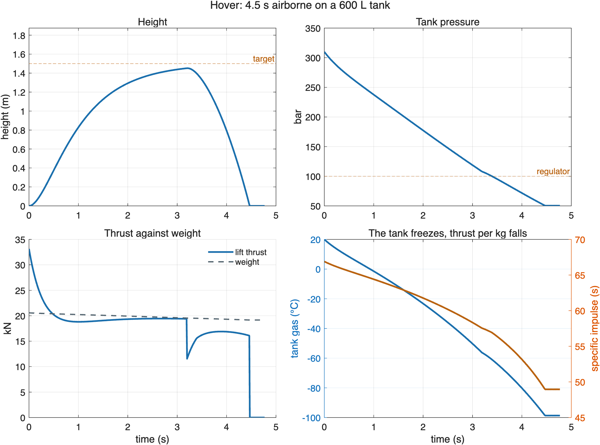 | 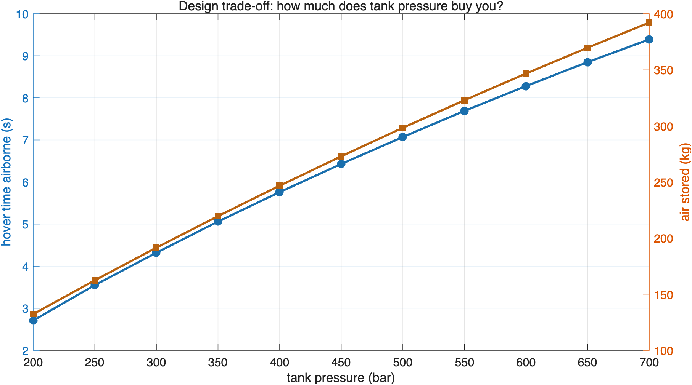 |
| 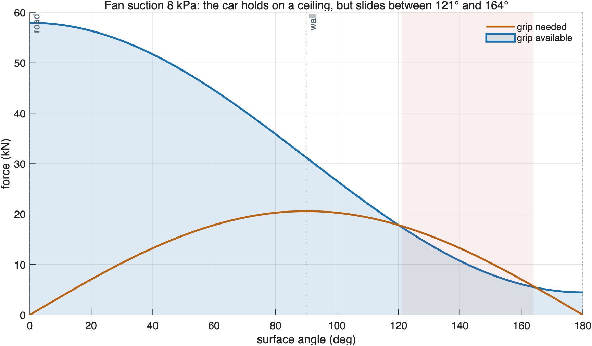 | 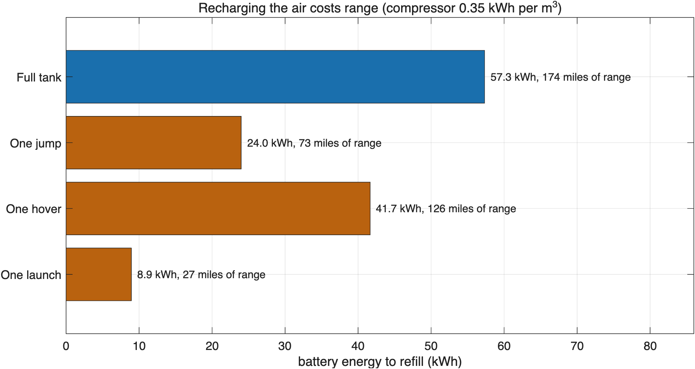 |

Full Simulink vs web comparison: [docs/validation.md](docs/validation.md).

---

## Known vs assumed

| | Value | Source |
|---|---|---|
| Thrusters on the demo car | 10 | Tesla |
| Compressed-air tank | 600 L, rechargeable | Tesla |
| Suction fans in the rear diffuser | strong enough to hold the car upside down | Tesla |
| 0-60 mph, Thrust trim (2 rear thrusters) | under 1 s | Tesla |
| Range, top speed | 300 mi, 230+ mph | Tesla |
| Tank pressure | 310 bar | assumed |
| Car mass with empty tank | 1,900 kg | assumed |
| Regulator pressure, nozzle area ratio | 100 bar, 8 | assumed |
| Thrust per nozzle (rear / lift / attitude) | 13 / 13 / 5 kN | assumed |
| Tyre grip, motor power, drag area | 1.3, 950 kW, 0.55 m² | assumed |
| Sealed underbody area | 3 m² | assumed |

Every assumption lives in one place: `web/physics.js` (parameter block `P`) and `matlab/rtl_params.m`.

## Limits

The model is 2D (no yaw or roll), ignores aerodynamic lift and suspension travel, and treats the tank as adiabatic. That makes the hover time a floor: a real tank picks up some heat from its walls.

## Repository layout

```
web/            interactive model: index.html, app.js (UI), physics.js (physics), tests
matlab/         rtl_params.m, rtl_plan_jump.m, build_roadster_models.m, run_all.m
matlab/models/  RoadsterJump.slx, RoadsterHover.slx, RoadsterLaunch.slx
docs/           figures, validation.md
```

## Sources

- [Reuters via Virginia Business: Tesla's new Roadster turns in air with SpaceX thrusters (16 Oct 2026)](https://virginiabusiness.com/tesla-roadster-spacex-thrusters-production-2028/)
- [The EV Report: thruster count and the 600 L tank](https://theevreport.com/tesla-roadster-unveil-spacex-cold-gas-thrusters)
- [Trending Topics: how the fans and thrusters work](https://www.trendingtopics.eu/tesla-spacex-roadster-cold-gas-thrusters-merger/)
- [Jalopnik: earlier cold-gas thruster estimates](https://jalopnik.com/1847047575)

## Licence

MIT. Built by Krishna Iyer.
